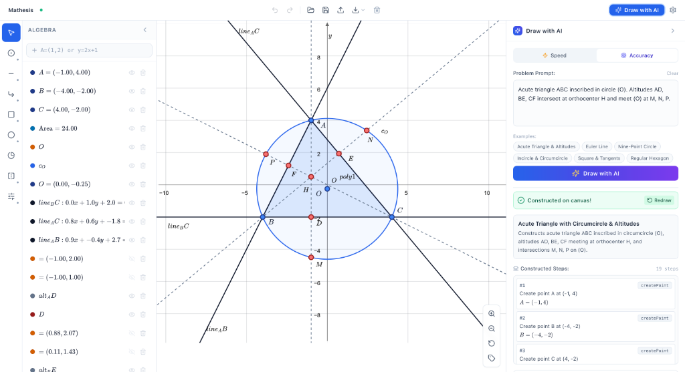

# Mathesis

Mathesis is a fast, minimalist dynamic geometry app with an AI-powered figure drawer.



### What it can do

- Interactive dynamic geometry canvas
- Draw with AI from problem statements
- Algebra sidebar with LaTeX equations
- Export PNG, SVG, PDF & import GeoGebra (.ggb)
- Offline-first with local auto-save

### Running locally

```bash
git clone https://github.com/nploc1209/mathesis.git
cd mathesis
npm install
npm run dev
```

### Built with

- React & TypeScript (front-end)
- JSXGraph & KaTeX (geometry & math)
- Tailwind CSS & Vite
- Cloudflare Pages
